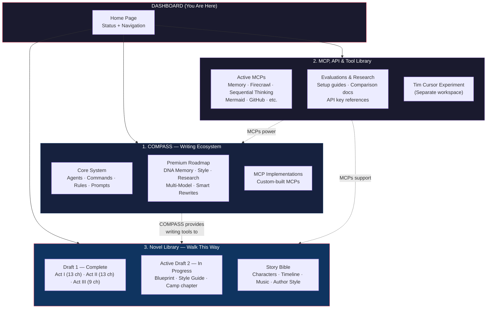
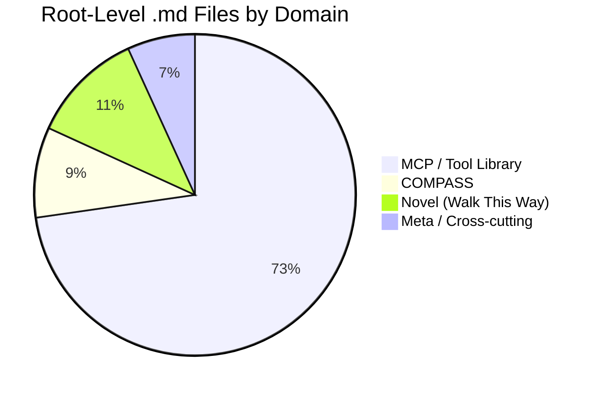
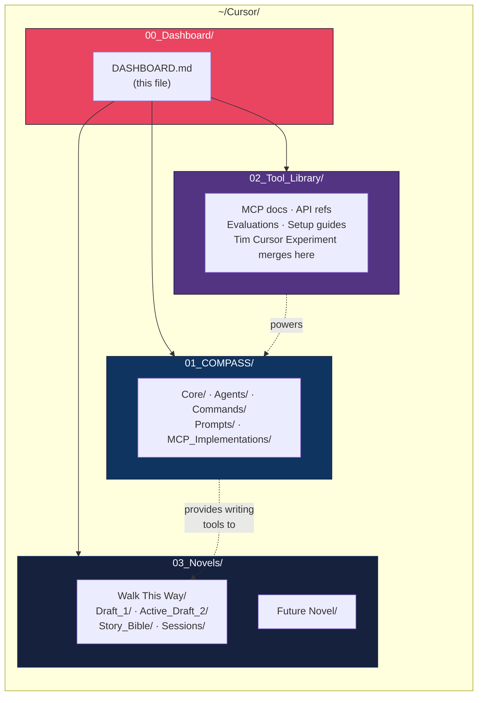

# DASHBOARD — Tim's Cursor Creative Writing Universe

**Last Updated:** February 8, 2026
**Purpose:** Single-pane overview of all four work areas — what they are, where they live, and their current status.

---

## Architecture Overview

---

## Area 1: COMPASS — Writing Ecosystem

> *The portable creative writing system that travels with you from project to project.*

**Location:** `zz_COMPASS/` + root-level COMPASS docs
**Status:** Core implemented. Premium designed but not fully built.

### What It Contains

| Component | Location | Files | Status |
|-----------|----------|-------|--------|
| **Core 5 Agents** | `zz_COMPASS/Agents/Core_5/` | 5 agents (JSON + MD pairs) | Implemented |
| **Special Agents** | `zz_COMPASS/Agents/Special/` | CAROLINA, HANK, JAZZ | Implemented |
| **Master Agent** | `zz_COMPASS/Agents/Master/` | Agent.json | Implemented |
| **26 Commands** | `zz_COMPASS/Commands/` | voice, pacing, dialogue, tension, etc. | Implemented |
| **Core Docs** | `zz_COMPASS/Core/` | Writing DNA, Advanced Tools, Templates | Implemented |
| **MCP Implementations** | `zz_COMPASS/MCP_Implementations/` | Custom-built MCPs (7,000+ files) | Mixed |
| **Prompts** | `zz_COMPASS/Prompts/` | JSON prompts | Implemented |

### COMPASS Premium Roadmap (10 Features)

| # | Feature | Status | Depends On |
|---|---------|--------|------------|
| 1 | Writing DNA Memory System | Designed | Memory MCPs integration |
| 2 | Smart Rewrites (Liberty Levels) | Designed | SmartWrite system |
| 3 | Agent Choreography | Designed | Advanced Sequential Thinking MCPs |
| 4 | Novel Kickoff Protocol | Designed | Core complete |
| 5 | Advanced Error Tracking | Designed | Quality assurance workflow |
| 6 | Multi-Model Orchestration | Designed | ZEN MCP + OpenAI/Google APIs |
| 7 | Advanced Memory Integration | Designed | All memory MCPs tested |
| 8 | Style System Integration | Designed | Style Emulation MCPs |
| 9 | Research System Integration | Designed | Firecrawl + Vectara APIs |
| 10 | Workflow Automation | Designed | n8n setup |

### Root-Level Files That Belong to COMPASS

These files are currently at the workspace root but are part of the COMPASS domain:

- `COMPASS_MCP_MANIFEST.md` — MCP requirements for COMPASS
- `COMPASS_PREMIUM_ROADMAP.md` — Full premium integration plan
- `COMPASS_SYSTEMS_VS_MCP_ANALYSIS.md` — Architecture analysis
- `SEQUENTIAL_THINKING_COMPASS_PREMIUM_COMPLETE.md`

---

## Area 2: MCP, API & Cursor Tool / Claude Library

> *The technical infrastructure — every MCP, API, extension, and tool evaluation.*

**Location:** Scattered across root + `Tim Cursor Experiment/` workspace
**Status:** Partially organized. Research docs need consolidation.

### Active MCP Servers (This Workspace)

| MCP Server | Category | Status |
|------------|----------|--------|
| walk-this-way (filesystem) | Core | Active |
| sequential-thinking | Core / Reasoning | **Errored — needs restart** |
| memory | Memory | Check status |
| mcp-mermaid | Visualization | Active |
| github | Version Control | Active |
| gitkraken | Version Control | Active |
| firecrawl | Research | Active |
| duckduckgo-search | Research | Active |
| Firebase | Backend | Active |
| Netlify | Deployment | Active |
| Perplexity | Research | Active |
| PostHog | Analytics | Active |
| Vale | Prose Linting | Active |
| mcp-open-library | Reference | Active |

### API Keys Status

| API | Status | Used By |
|-----|--------|---------|
| ANTHROPIC_API_KEY | Secured | Claude, Style Emulation, ZEN |
| GITHUB_TOKEN | Secured | GitHub MCP |
| FIRECRAWL_API_KEY | **Needed** | Firecrawl MCP |
| VECTARA_API_KEY | **Needed** | Vectara MCP |
| OPENAI_API_KEY | **Needed** | ZEN MCP |
| GOOGLE_API_KEY | **Needed** | ZEN MCP |

### Root-Level Files That Belong to MCP/Tool Library

These files are currently at the Walk This Way root but belong to the MCP/Tool domain:

- `MCP_ADDITIONS_REQUIRED.md`
- `MCP_ARSENAL_RANKED_PRIORITY.md`
- `MCP_COMPLETE_ACTIVE_LIST.md`
- `MCP_EVALUATION_GUIDE.md`
- `MCP_FINAL_EVALUATION_COMPLETE.md`
- `MCP_ORCHESTRATION_STRATEGY.md`
- `MCP_POWERHOUSE_INTEGRATION_ANALYSIS.md`
- `MCP_SETUP_SUMMARY.md`
- `MCP_UNINSTALLED_SEQUENTIAL_ANALYSIS.md`
- `MCPs_TO_CONSIDER_REFERENCE.md`
- `API_SETUP_PROGRESS.md`
- `CURSOR_EXTENSIONS_GUIDE.md`
- `CURSOR_PRO_VS_ULTRA_ANALYSIS.md`
- `CURSOR_SETUP_COMPLETE.md`
- `CURSOR_SUPER_AGENT_ACTION_PLAN.md`
- `CURSOR_BUILT_IN_TOOLS_SEQUENTIAL_THINKING.md`
- `AUTOMATION_SYSTEM_COMPLETE.md`
- `ANTHROPIC_MCP_VERIFICATION_COMPLETE.md`
- `PROFESSIONAL_EDITOR_MCP_SETUP_COMPLETE.md`
- `FICTION_REVERSE_ENGINEERING_MCP_COMPLETE.md`
- `STYLE_EMULATION_MCP_INSTALLATION_COMPLETE.md`
- `STYLE_EMULATION_MCP_SETUP_COMPLETE.md`
- `STYLE_EMULATION_DENNIS_LEHANE_INTEGRATION_ANALYSIS.md`
- `GitKraken_MCP_Setup_Summary.md`
- `SEQUENTIAL_THINKING_EXECUTION_EVALUATION.md`
- `SEQUENTIAL_THINKING_MCP_REFERENCE.md`
- `SEQUENTIAL_THINKING_QUICK_WINS_AUTOMATION.md`
- `QUICK_WINS_EXAMPLE_TEMPLATE.md`
- `QUICK_WINS_OPTIMIZATION_COMPLETE.md`
- `QUICK_WINS_TEST_EXECUTION.md`
- `JAZZ_CHAT_QUICK_WINS.md`
- `TERMINAL_STATUS_CHECK.md`
- `SPELL_CHECKER_GUIDE.md`

### Tim Cursor Experiment Workspace (Separate)

| Folder | Contents | Notes |
|--------|----------|-------|
| `research/mcp/` | MCP guides, API refs, orchestration docs | 7 files |
| `research/fiction-writing/` | Fiction MCP guides, Story Bible templates | 6 files |
| `research/deliverance/` | Deliverance novel reverse-engineering | 6 files |
| `research/sequential-thinking/` | Sequential Thinking setup + reports | 2 files |
| `research/general/` | Cross-cutting summaries | 1 file |
| `scripts/` | GitHub push, VSIX install | 3 files |

---

## Area 3: Novel Library — Walk This Way

> *The novel itself — drafts, story bible, session history, and review pipeline.*

**Location:** Draft folders + Story_Bible + supporting folders in this workspace
**Status:** Draft 1 complete (35 chapters). Draft 2 in early stages.

### Draft 1 — Complete (Source Material)

| Act | Chapters | Range |
|-----|----------|-------|
| **Act I** | 13 chapters | Prologue through Ch 12 (Dan's Death) |
| **Act II** | 13 chapters | Ch 13 (Maxanne Act 2) through Ch 25 (Eve of Battle) |
| **Act III** | 9 chapters | Ch 26 (Battle Begins) through Ch 34 (Epilogue) |

**Total:** 35 chapters across 3 acts

### Active Draft 2 — In Progress

| File | Status | Action Required |
|------|--------|-----------------|
| `DRAFT_2_MASTER_BLUEPRINT_V2.md` | Needs Review | Print, add ((notes)), expand chapters |
| `DRAFT_2_STYLE_GUIDE.md` | Needs Review | Print, add ((notes)) |
| `Camp_Winnipesaukee` chapters | Working drafts | Multiple versions in progress |

### Story Bible

| Document | Purpose |
|----------|---------|
| `character-bible.md` | Full character profiles |
| `timeline.md` | Chronological story events |
| `music-references.md` | Songs and musical references |
| `author-style-library.md` | Style DNA and influences |
| 10 reference screenshots | Visual reference material |

### Supporting Folders

| Folder | Purpose | Files |
|--------|---------|-------|
| `Session_Summaries/` | Historical session records | 8 files |
| `First_Drafts/` | Early draft material | 3 files |
| `SmartWrite/` | Rewrite system docs | 4 files |
| `Agent_Work/` | Agent-generated analysis | 40 files |
| `Completed/` | Finished items | 1 file |
| `In_Review/` | Review pipeline | README only |
| `Questions/` | Open questions | 1 example |

### Root-Level Files That Belong to the Novel

- `CHAPTER_CRITIQUE_GUIDE.md`
- `CURRENT_DOCUMENTS_OUTLINE.md`
- `STRUCTURAL_ANALYSIS_FOUR_QUADRANTS.md`
- `SESSION_PREP.md`
- `TODO_SUMMARY.md`

---

## The Entanglement Problem

Here's what the current state looks like — everything lives in one workspace:

**32 files** at the root belong to the MCP/Tool domain but live inside a novel workspace. This is the core tangle.

### Separation Strategy

When you're ready to untangle, here's the clean architecture:

| Step | Action | Complexity |
|------|--------|------------|
| 1 | Move COMPASS root docs into `zz_COMPASS/` | Low |
| 2 | Move MCP/Tool docs into a `Tool_Library/` folder (or separate workspace) | Medium |
| 3 | Merge `Tim Cursor Experiment` research into Tool Library | Medium |
| 4 | Clean novel root to only novel files | Low |
| 5 | (Future) Split into separate Cursor workspaces | Higher — needs MCP config per workspace |

---

## Quick Reference

| Area | Shortcut | Key File |
|------|----------|----------|
| COMPASS | `zz_COMPASS/` | `COMPASS_PREMIUM_ROADMAP.md` |
| MCP/Tools | Root `MCP_*.md` files | `MCP_COMPLETE_ACTIVE_LIST.md` |
| Novel | `Draft_1/` + `Active_Draft_2/` | `DRAFT_2_MASTER_BLUEPRINT_V2.md` |
| Story Bible | `Story_Bible/` | `character-bible.md` |
| This Dashboard | Root | `DASHBOARD.md` |

---

## Errored MCPs — Action Needed

| MCP | Status | Fix |
|-----|--------|-----|
| Sequential Thinking | Errored | Cursor Settings > MCP > Restart |

---

*This dashboard is a living document. Update it as areas get reorganized and separated.*
